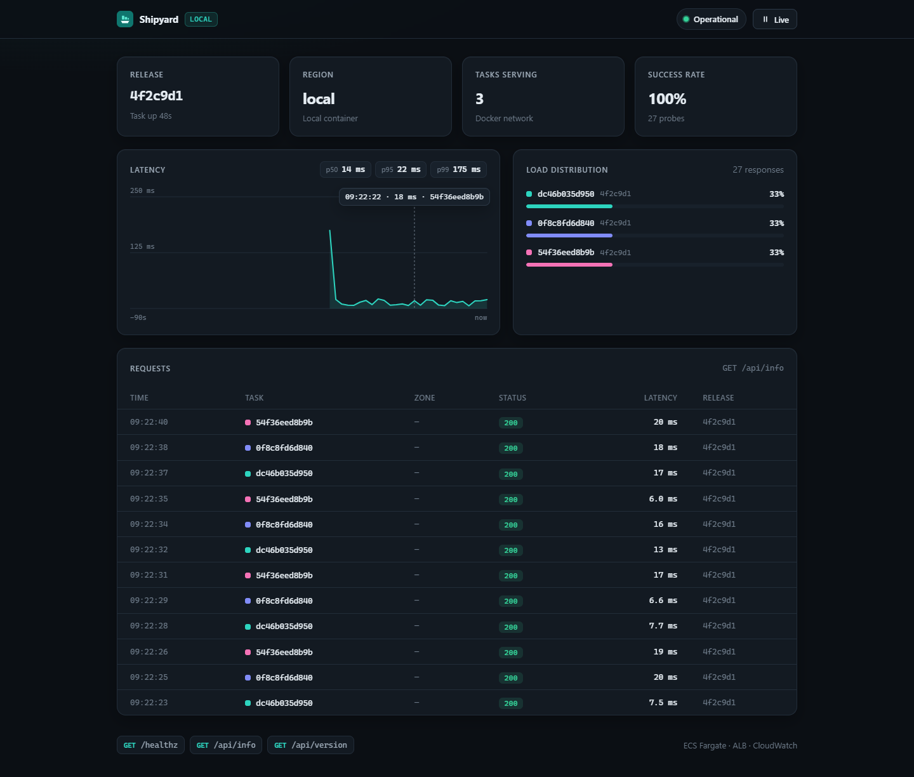
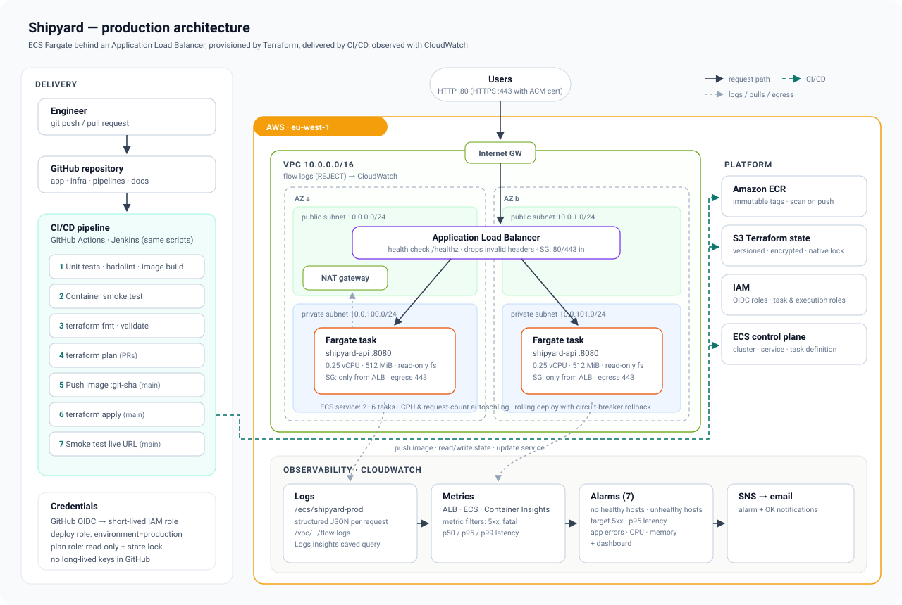
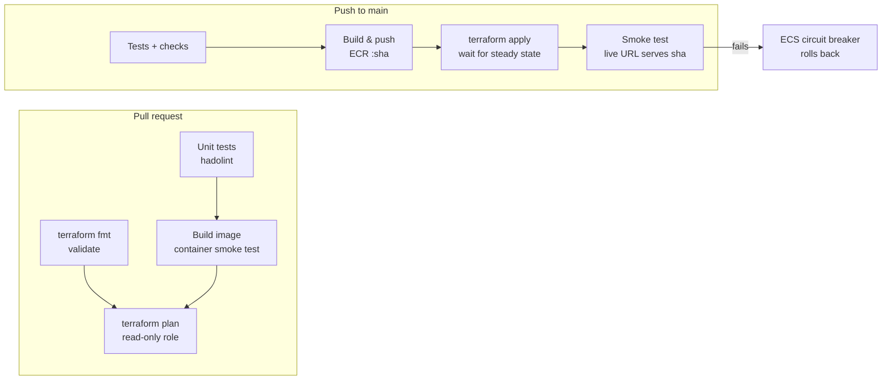

# Shipyard

[](https://github.com/Asmodeus8/shipyard/actions/workflows/pipeline.yml)


A containerised web service deployed to **AWS ECS Fargate** behind an **Application Load Balancer**. Terraform provisions it, a **CI/CD pipeline** (GitHub Actions, with an equivalent Jenkins pipeline) ships it, and **CloudWatch** monitors it.

A push to `main` runs tests, builds and scans an image, pushes it to ECR, applies Terraform, rolls the ECS service, and smoke-tests the live URL. You do nothing by hand after the one-time bootstrap.

**Live:** http://shipyard-prod-2113359311.eu-west-1.elb.amazonaws.com (while the review stack is running)



The service serves a small operations console. It probes the load balancer every 1.5 s and shows:
- which release is live
- which Fargate task and Availability Zone answered each request
- latency percentiles
- a banner while a rolling deployment is replacing tasks

That makes load balancing, multi-AZ placement and zero-downtime rollouts visible.

---

## Contents

1. [Architecture](#architecture)
2. [Repository layout](#repository-layout)
3. [Run it locally](#run-it-locally)
4. [Deploy to AWS](#deploy-to-aws)
5. [CI/CD pipeline](#cicd-pipeline)
6. [Monitoring and logging](#monitoring-and-logging)
7. [Design decisions](#design-decisions)
8. [Security](#security)
9. [Assumptions](#assumptions)
10. [Limitations and improvements](#limitations-and-improvements)
11. [Cost](#cost)

---

## Architecture



**Request path:** Users → Internet Gateway → ALB (public subnets, 2 AZs) → ECS Fargate tasks (private subnets, no public IPs). Tasks reach ECR and CloudWatch through a NAT gateway.

**Delivery path:** git push → pipeline → image pushed to ECR as `:<git-sha>` → `terraform apply` registers a new task definition revision → ECS rolls the service (min 100 % healthy, max 200 %) → the pipeline waits for steady state → a smoke test confirms the live URL serves the new SHA.

| Layer | Resources | Terraform |
|---|---|---|
| Network | VPC, 2 public + 2 private subnets across 2 AZs, IGW, NAT, route tables, VPC flow logs | [`modules/network`](infra/modules/network) |
| Edge | ALB, target group (`ip` targets), HTTP listener, optional HTTPS listener with TLS 1.3 policy, security group | [`modules/alb`](infra/modules/alb) |
| Compute | ECS cluster (Container Insights), task definition, service with circuit-breaker rollback, IAM task/execution roles, autoscaling (CPU + requests per target) | [`modules/ecs-service`](infra/modules/ecs-service) |
| Observability | Log metric filters, 7 alarms, SNS topic, dashboard, saved Logs Insights query | [`modules/monitoring`](infra/modules/monitoring) |
| Registry | ECR with immutable tags, scan on push, lifecycle policy | [`modules/ecr`](infra/modules/ecr) |
| Bootstrap | S3 state bucket, ECR, GitHub OIDC provider, deploy and plan roles | [`infra/bootstrap`](infra/bootstrap) |

### Pipeline flow



---

## Repository layout

```
.
├── app/                    Node.js service + console UI
│   ├── src/                HTTP server, routes, ECS metadata
│   ├── public/             console (HTML/CSS/JS, no build step, strict CSP)
│   ├── test/               node:test suite
│   └── Dockerfile          multi-stage: deps → test → runtime (non-root, read-only)
├── infra/
│   ├── bootstrap/          one-time: state bucket, ECR, OIDC roles
│   ├── modules/            network · alb · ecs-service · monitoring · ecr
│   ├── stack/              root module composing the modules
│   └── envs/               prod.tfvars · staging.tfvars
├── scripts/                build-push · terraform · smoke-test · bootstrap
├── .github/                pipeline · rollback · destroy workflows, Dependabot
├── Jenkinsfile             same stages for Jenkins
├── jenkins/                Jenkins controller as code (JCasC, plugins, compose)
├── .checkov.yaml           IaC scan policy and accepted risks
├── docker-compose.yml      local stack: 3 replicas behind nginx
└── docs/                   architecture diagram, screenshots
```

---

## Run it locally

Requirements: Docker.

```bash
docker compose up -d --build --wait
open http://localhost:8080
```

This runs three replicas behind an nginx round-robin proxy, which stands in for the ALB, so the console shows requests spreading across tasks just as it does on ECS.

```bash
cd app && npm test        # 8 tests, no dependencies to install
docker compose down
```

| Endpoint | Purpose |
|---|---|
| `GET /` | Operations console |
| `GET /healthz` | ALB and container health check; returns `503` while draining on `SIGTERM` |
| `GET /api/info` | Version, task ID, AZ, uptime, request counters |
| `GET /api/version` | Release SHA and environment (used by the smoke test) |

---

## Deploy to AWS

### Prerequisites

- An AWS account and credentials with admin rights, used **once** for the bootstrap
- Terraform ≥ 1.10, the AWS CLI v2, and the GitHub CLI (`gh auth login`)
- This repository on GitHub

### 1. Bootstrap (one time)

```bash
./scripts/bootstrap.sh <github-owner>/<repo> eu-west-1
```

This creates the Terraform state bucket, the ECR repository, the GitHub OIDC provider, and two IAM roles. It then writes `AWS_REGION`, `TF_STATE_BUCKET`, `AWS_DEPLOY_ROLE_ARN` and `AWS_PLAN_ROLE_ARN` as GitHub repository variables and creates the `production` environment. No secrets are stored in GitHub.

### 2. Deploy

```bash
git push origin main
```

The pipeline builds, pushes, applies and smoke-tests. The job summary links to the service URL and the CloudWatch dashboard. Every later push to `main` repeats the same steps. Pull requests get a `terraform plan` from a read-only role.

To receive alarm emails, add addresses to `alarm_emails` in `infra/envs/prod.tfvars` and confirm the SNS subscription email.

### 3. Roll back

Run the **rollback** workflow and enter the commit SHA of an earlier release (short or full). It checks that the commit exists and that its image is in ECR, redeploys that image through the same Terraform apply, and smoke-tests that the old version is serving. The next push to `main` rolls forward again.

```bash
gh workflow run rollback -f release=2399cd5
```

### 4. Tear down

Run the **destroy** workflow in the Actions tab and type the environment name to confirm. Then remove the bootstrap stack with `terraform -chdir=infra/bootstrap destroy`.

### Using Jenkins instead

The `Jenkinsfile` runs the same stages and calls the same scripts. The `jenkins/` folder holds a controller defined entirely as code: plugins, the admin user, the AWS credential, and the multibranch job, all seeded by JCasC.

```bash
terraform -chdir=infra/bootstrap apply -var github_repository=<owner>/<repo> -var create_jenkins_user=true
aws iam create-access-key --user-name shipyard-jenkins     # put the key in jenkins/.env
cp jenkins/.env.example jenkins/.env                       # fill in values
docker compose -f jenkins/docker-compose.yml up -d --build # http://localhost:8081
```

Jenkins scans the repository every 5 minutes. It runs verification on every branch, and push/deploy/smoke stages only on `main`.

---

## CI/CD pipeline

[`pipeline.yml`](.github/workflows/pipeline.yml)

| Job | Trigger | What it does |
|---|---|---|
| **Build & test** | every push and PR | `npm test`, hadolint, Docker build of the `test` stage (tests run inside the image build), runtime image build, **Trivy** scan (fails on fixable HIGH/CRITICAL CVEs), container run + smoke test |
| **Terraform checks** | every push and PR | `fmt -check`, `validate` for the bootstrap and the stack, **Checkov** policy scan |
| **Terraform plan** | PRs | Plan against real state using the read-only role; result in the job summary |
| **Push image** | `main` | Build and push `:<git-sha>`; skipped if the tag exists (tags are immutable) |
| **Deploy to ECS** | `main` | `terraform apply` (waits for ECS steady state), smoke test until 5 consecutive responses serve the new SHA, then summary |

[`rollback.yml`](.github/workflows/rollback.yml) redeploys an earlier release on demand, and [`destroy.yml`](.github/workflows/destroy.yml) tears an environment down. Dependabot opens weekly grouped updates for Actions, base images, Terraform providers and npm.

Pipeline guarantees:
- **Concurrency:** deploys are serialised (`deploy-production`, never cancelled midway), and superseded PR runs are cancelled.
- **Repeatability:** the image tag is the commit SHA, and the infrastructure is declared in Terraform. Re-running a deploy for the same commit is a no-op.
- **Zero downtime (measured):** probing the live URL once per second during a deploy gave 367 requests and 0 errors. Traffic moved from the old release, through a mixed phase, to the new one.
- **Safety:** ECS rolls the deployment back on its own when new tasks fail health checks, and the pipeline then fails because steady state is never reached.

---

## Monitoring and logging

**Logs.** The app writes one JSON line per request (`method`, `path`, `status`, `durationMs`, …) to stdout. The `awslogs` driver ships it to `/ecs/shipyard-prod` with 30-day retention. VPC flow logs record rejected traffic. A saved Logs Insights query, `shipyard-prod/slow-requests`, ranks paths by p95 latency.

**Metrics.** ALB metrics, ECS metrics, and Container Insights (enhanced), plus two custom metrics from log filters: `ServerErrors` and `FatalErrors`.

**Alarms** (each one notifies the SNS topic on ALARM and on OK):

| Alarm | Condition |
|---|---|
| `no-healthy-hosts` | Healthy targets < 1 for 2 min (missing data counts as breaching) |
| `unhealthy-hosts` | Any unhealthy target for 2 min |
| `alb-target-5xx` | More than 5 target 5xx responses in 5 min |
| `latency-p95` | p95 response time > 1 s for 3 min |
| `app-errors` | Logged 5xx + fatal errors > 5 in 5 min |
| `cpu-high` / `memory-high` | > 85 % for 5 min, which means autoscaling is already at its limit |

**Dashboard.** Requests and errors, p50/p95/p99 latency, CPU/memory, healthy targets and running tasks, app errors from logs, alarm status, and a live table of recent error logs. Its URL is a Terraform output.

---

## Design decisions

| Decision | Why |
|---|---|
| **ECS Fargate** over EC2/EKS | No hosts to patch or scale, and per-task IAM and security groups. EKS adds a control plane and cluster operations that a single service doesn't need. |
| **Terraform owns the task definition**; CI passes `image_tag` | One source of truth. No drift between what CI deploys and what Terraform plans, and every deploy is a reviewed, reproducible `apply`. |
| **Immutable image tags = git SHA** | Every running task traces to a commit. Rollback means redeploying an older SHA. |
| **Rolling deploy + circuit breaker** instead of blue/green | Zero downtime with automatic rollback and no extra CodeDeploy setup. Blue/green is listed under improvements. |
| **`wait_for_steady_state`** | The pipeline fails when the rollout fails, rather than reporting green on a broken release. |
| **Private subnets + single NAT** | Tasks are not reachable from the internet. One NAT saves about $35/month; `single_nat_gateway = false` gives one per AZ. |
| **S3 native state locking** (`use_lockfile`) | Terraform ≥ 1.10 locks in S3 directly, so no DynamoDB table is needed. |
| **Bootstrap stack kept separate** | The state bucket can't store its own state, and ECR/IAM outlive any one environment. Environments are `tfvars` files plus a state key, with no copy-pasted roots. |
| **OIDC, two roles** (classic and immutable `sub` claims accepted) | No long-lived keys in GitHub. PRs can only plan (read-only). Only the `production` environment can assume the deploy role, which allows only the services the stack uses and only IAM roles prefixed `shipyard-`. |
| **Shared shell scripts** for build/deploy/smoke | GitHub Actions and Jenkins run identical logic, so the CI system is swappable. |
| **Zero-dependency Node service** | No supply-chain surface to audit. Tests use the built-in `node:test`, and the image is just Alpine Node plus the app. |
| **Tests run inside the image build** | The image that ships is built from the same layers that passed the tests. |
| **Graceful shutdown** | On `SIGTERM` the app fails `/healthz` and drains for 5 s, so the ALB deregisters it before connections close. The keep-alive timeout (65 s) exceeds the ALB idle timeout (60 s) to avoid 502s. |

---

## Security

- Tasks run in private subnets. The task security group accepts traffic only from the ALB security group, and egress is 443 only.
- The container runs as a non-root user with a read-only root filesystem.
- The app sends a strict CSP, `X-Frame-Options: DENY`, `nosniff` and `no-referrer`. The console loads no third-party scripts, styles or fonts.
- The ALB drops invalid header fields. With a certificate, HTTP redirects to HTTPS on the TLS 1.3 policy.
- ECR scans every image on push, and CI blocks on Trivy findings before the image is pushed. The runtime image ships without npm, yarn or corepack, which removes every CVE the scan found in the base image.
- Checkov scans all Terraform on every change (187 checks pass). Checks that conflict with a deliberate choice are skipped in [`.checkov.yaml`](.checkov.yaml), with the reasons below.
- The state bucket is versioned, encrypted, blocks public access, denies non-TLS requests, and expires old state versions after 90 days.

<details>
<summary>Accepted Checkov findings</summary>

| Check | Why it is accepted |
|---|---|
| `CKV_AWS_2`, `CKV_AWS_260`, `CKV_AWS_378` | No domain is available, so the ALB listens on HTTP. Setting `certificate_arn` adds HTTPS and turns port 80 into a redirect. Targets are in private subnets, so ALB → task traffic stays on HTTP inside the VPC. |
| `CKV2_AWS_28` | WAF costs more than the rest of the stack. It is listed under improvements. |
| `CKV_AWS_91` | Request logs come from the app's structured JSON logs. ALB access logs would need a separate bucket for no new information. |
| `CKV_AWS_150` | Deletion protection would block the destroy workflow, which reviewers need. |
| `CKV_AWS_136`, `CKV_AWS_145`, `CKV_AWS_158`, `CKV_AWS_26` | Data is encrypted at rest with AWS-owned keys. Customer-managed KMS keys add cost and key policy work, and SNS with an AWS-managed key would stop CloudWatch from delivering alarms. |
| `CKV_AWS_338` | Logs are kept for 30 days to keep cost low. Retention is one variable. |
| `CKV_AWS_144`, `CKV_AWS_18`, `CKV2_AWS_62` | Cross-region replication, access logging and event notifications on the state bucket are overkill for one environment. Versioning covers recovery. |
| `CKV_AWS_394` | The network module takes the first `az_count` zones in name order, so a zone added to the region later does not move any subnet. |

</details>

---

## Assumptions

- A single region (`eu-west-1`, three AZs, mature service coverage) and a single production environment are enough. `staging.tfvars` shows how a second environment is added.
- No custom domain is available, so the ALB DNS name over HTTP is acceptable for review. Passing `certificate_arn` turns on HTTPS.
- The service is stateless, so no database, cache or secrets are needed.
- The GitHub repository is the source of truth, and `main` is the release branch.

---

## Limitations and improvements

- **HTTPS by default:** add Route 53 + ACM (DNS-validated) and AWS WAF in front of the ALB.
- **Blue/green or canary:** CodeDeploy for ECS or ALB weighted target groups, gated on the CloudWatch alarms.
- **Promotion:** deploy to `staging` first and promote the same SHA to `prod` after approval.
- **Bootstrap state:** the bootstrap stack keeps local state. Migrate it into the bucket after the first apply, or manage it from an org-level account.
- **Least privilege:** the deploy policy is scoped by service, region and name prefix. It could be tightened further to resource ARNs and tag conditions.
- **Supply chain:** sign images with cosign and verify the signature at deploy time. Pin the scanner images by digest.
- **Tracing:** OpenTelemetry → AWS X-Ray for per-request traces.
- **Cost:** VPC endpoints for ECR/Logs/S3 can replace NAT traffic; Fargate Spot for non-prod.

---

## Cost

Approximate monthly cost in `eu-west-1` with default settings:

| Item | ~USD / month |
|---|---|
| NAT gateway (1) | 35 |
| Application Load Balancer | 18 |
| Fargate, 2 × (0.25 vCPU, 0.5 GB) | 18 |
| Public IPv4 addresses (ALB + NAT) | 11 |
| CloudWatch (logs, alarms, dashboard, Container Insights) | 5–10 |
| **Total** | **~90** (about $3/day) |

Run the **destroy** workflow when you're done reviewing.

---

## License

[MIT](LICENSE)
